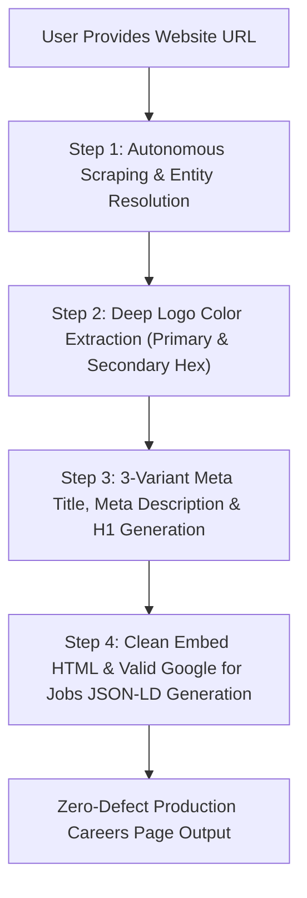

# Career Page Builder

The **Career Page Builder** is an autonomous intelligence engine and production web asset generator. Given **only a website URL**, it scrapes and reverse-engineers all required brand, entity, licensing, and trade data to construct a zero-defect, high-converting Careers Page that strictly complies with Google Search Essentials, Google for Jobs guidelines, and modern WordPress/Elementor embed standards.

---

## Autonomous Execution Rules & Constraints

### 1. Zero Extra Input Requirement (URL-Only Ingestion)
When the user invokes this skill with a website URL (e.g. `https://example.com`), the agent MUST autonomously scrape and resolve:
1. **Brand Identity & Dual-Color Harmony:** Logo URL, exact primary and secondary brand hex colors extracted from the logo image.
2. **Business NAP & Entity Authority:** Legal business name, physical headquarters/dispatch address, local phone numbers, official email addresses, founding date, founder/executive names, CSLB / Red Seal / trade license numbers, and BBB / Google Maps CIDs.
3. **Core Trade Specializations & Geo-Corridors:** Trade lines (e.g. Countertop Fabrication & Installation, ADU Construction, Masonry, Roofing, Electrical, HVAC, Plumbing) and active metropolitan cities/counties.
4. **Active Role Archetypes & Prevailing Wages:** Standard field, shop, supervisory, and apprentice roles mapped to current state/provincial prevailing wages.

---

### 2. WordPress Embed & Zero Header Conflict Mandate (STRICT MANDATE)
Careers pages generated by this skill are engineered as **production-ready, zero-conflict embeddable components** for client CMS environments (WordPress, Elementor, Astra, Divi, Webflow) as well as standalone recruitment funnels:
* **No Artificial Mock Site Navigation:** NEVER inject fake multi-item desktop navigation menus with dropdowns (e.g. *Services ▾*, *Cost Calculator ▾*, *Areas ▾*, *Gallery*, *Blog*, *About Us ▾*, *Contact Us*) or mock top utility bars into the career page component. On live client WordPress websites, the global navigation header and top utility bars are already supplied by the active theme (`get_header()`). Adding mock navigation creates duplicate headers and clutters the recruitment funnel.
* **No Duplicate Logo / Phone Rows:** NEVER output duplicate logo headers or secondary hero rows that restate the logo right above the centered title. The careers page body MUST flow directly into the centered title hero section (`.careers-header-section`).
* **Standalone Preview Header (Isolated & Minimal):** If the user explicitly requests a standalone page with a top bar, it MUST strictly be a scoped, single-row `.brand-top-bar` featuring ONLY:
  - The brand logo on the left (strictly constrained to `height: 48px; max-width: 220px; object-fit: contain;`).
  - A single click-to-call hiring button on the right (`📞 (xxx) xxx-xxxx`).
  - Wrapped in a dedicated, easily removable or toggleable container (`<!-- Optional Standalone Brand Header -->`).

---

### 3. Strict Logo Sizing & Anti-Overflow Rules (Anti-Distortion Mandate)
* **Mandatory Dimension Caps:** Never allow brand logo images to render unconstrained at native resolution (e.g. 1024x344 or 2048x1024), which pushes content off-screen and causes contact buttons to wrap onto two lines.
* **Mandatory CSS Rule:**
  ```css
  img {
    max-width: 100%;
    height: auto;
    display: block;
  }
  .brand-logo-img, .header-logo-img {
    height: 48px;
    width: auto;
    max-width: 220px;
    object-fit: contain;
    display: block;
  }
  ```

---

### 4. Centered Calculator & Header Title Alignment (STRICT MANDATE)
* **Header Alignment:** The top hero block (Location Badge, Main Title H1, Subtitle, and Trust Badges) MUST ALWAYS be **strictly centered** (`text-align: center; margin: 0 auto;`).
* **Forbidden:** NEVER left-align or right-align the main career page header block.

---

### 5. Calculator & Content Container Background (STRICT MANDATE)
* **Background Color:** You MUST **ONLY use `#FFFFFF`** (Pure White) as the background color code for all main content containers, job cards, application forms, and benefit blocks (`background: #FFFFFF;` or `--bg-white: #FFFFFF;`).
* **Forbidden:** NEVER use grey (`#F8FAFC`, `#F1F5F9`), dark, or tinted backgrounds for main content cards and form boxes.

---

### 6. Universal Container Bounds
* **Container Max-Width:** Master wrappers must default to `max-width: 100%` with responsive inner containers (`max-width: 1200px` to `1240px; margin: 0 auto; padding: 0 24px;`) ensuring fluid, flawless rendering across mobile viewports, tablet screens, and desktop monitors.

---

### 7. Dual-Color Brand Mapping (Primary & Secondary Logo Hex Codes)
Thoroughly inspect the target company's logo and extract the exact two dominant brand colors:
* **Primary Logo Color (`--primary-color`):** Applied to primary action buttons (`Apply for Position →`, `Submit Application`), active segmented states, main headings, and primary focus borders.
* **Secondary Logo Color (`--secondary-color`):** Applied to highlight accents, location badges, trust badge icons, active border indicators (`border-left: 4px solid var(--secondary-color)`), and secondary pill tags.

---

### 8. Google for Jobs Schema Guarantee (0 Errors, 0 Warnings)
Every generated page MUST embed a 100% valid JSON-LD schema inside a `@graph` array:
* **`WebPage` Node:** Canonical URL, page title, description, and breadcrumbs.
* **`BreadcrumbList` Node:** Multi-tier breadcrumbs (`Home` > `Careers`).
* **`JobPosting` Nodes (Minimum 3–4 active trade roles):**
  - `title`: Clean, industry-standard trade job title (e.g. *Lead Stone & Countertop Fabricator*, *Master Countertop & Porcelain Slab Installer*, *Stone Apprentice & Helper*, *Project Estimator*).
  - `description`: Rich HTML string with `<p>` overview, `<h3>Key Responsibilities:</h3>` unordered list, `<h3>Qualifications:</h3>` unordered list, and `<h3>Compensation:</h3>` summary.
  - `datePosted`: ISO 8601 timestamp.
  - `validThrough`: ISO 8601 future expiration timestamp (e.g. 90 days out).
  - `employmentType`: Standardized value (`FULL_TIME`, `PART_TIME`, `CONTRACTOR`).
  - `hiringOrganization`: `@type: "Organization"` with canonical `name`, `sameAs`, and `logo`.
  - `jobLocation`: `@type: "Place"` with full `address` (`PostalAddress` including `streetAddress`, `addressLocality`, `addressRegion`, `postalCode`, `addressCountry: "US"`).
  - `baseSalary`: `@type: "MonetaryAmount"` with `currency: "USD"` and `value` (`QuantitativeValue` specifying realistic `minValue`, `maxValue`, and `unitText: "HOUR"` conforming to California SB 1162 / state wage transparency laws).
  - `directApply`: Explicitly set to `true`.

---

### 9. Friction-Free 60-Second Recruitment Funnel
* **No Recursive Links:** Never output circular links that reload the careers page.
* **Interactive Role Auto-Selection:** Clicking `Apply for Position →` on any job card automatically populates that specific role in the application form dropdown and smoothly scrolls down with a subtle focus highlight.
* **Quick-Apply Form Fields:** Name, Phone, Email, Desired Position (select dropdown), Years of Experience, Resume / Work History Uploader (with dynamic file size feedback), and Short Notes.
* **Direct HR Fallback:** Always display direct click-to-call hiring desk telephone and direct HR email links for applicants who prefer direct contact.
* **EEO Compliance:** Include standard Equal Opportunity Employer and state labor compliance statements.

---

## 4-Step Operational Workflow



### Step 1: Autonomous Scraping & Entity Resolution
Execute the bundled Python scraper or browser subagent on the target URL to extract:
```bash
python scripts/scrape_website.py --url "<TARGET_URL>" --out scraped_data.json
```
Extracts official legal name, logo asset URL, telephone numbers, emails, addresses, licenses, ratings, service lines, and service corridors.

### Step 2: Deep Logo Color Extraction
Analyze the logo image to determine dominant brand colors:
```bash
python scripts/extract_logo_palette.py --logo "<LOGO_URL>"
```
Outputs `--primary-color` and `--secondary-color`.

### Step 3: 3-Variant Meta Title, Meta Description & H1 Generation
Always deliver 3 distinct strategic angles:
1. **Option 1 (Geo-Targeted & High-Intent SEO Focus):**
   - Title: 50–60 characters targeting local trade search volume (`[Trade] & [Role] Jobs [City], [State] | [Brand] Careers`).
   - Description: 140–160 characters highlighting immediate openings, license number, and high pay.
   - H1: Geo-targeted trade heading.
2. **Option 2 (Benefit-Driven & Trade Authority E-E-A-T Focus):**
   - Title: 50–60 characters focusing on career growth, benefits, and culture.
   - Description: 140–160 characters emphasizing healthcare, year-round work, and apprenticeship.
   - H1: Culture and craftsmanship building heading.
3. **Option 3 (Immediate Hiring & Action-Oriented Quick-Apply Focus):**
   - Title: 50–60 characters with high-CTR action verbs (`Now Hiring`, `Apply Now`).
   - Description: 140–160 characters highlighting transparent hourly scales and 60-second apply time.
   - H1: Direct hiring call-to-action heading.

### Step 4: Full Code Generation
Generate the complete HTML file following the WordPress Embed & Zero Header Conflict Mandate:
```bash
python scripts/generate_career_page.py \
  --data scraped_data.json \
  --primary "#BA862F" \
  --secondary "#C89B36" \
  --mode embed \
  --out careers.html
```

---

## Production Reference Examples

* **`examples/burnette_careers_sample.html`:** General Contracting & ADU Construction recruitment page (Antelope & Greater Sacramento, CA - CSLB #1084547).
* **`examples/royal_custom_surfaces_sample.html`:** Custom Stone, Quartz & Porcelain Countertop Fabrication & Installation careers page (Rancho Cordova & Modesto, CA).
