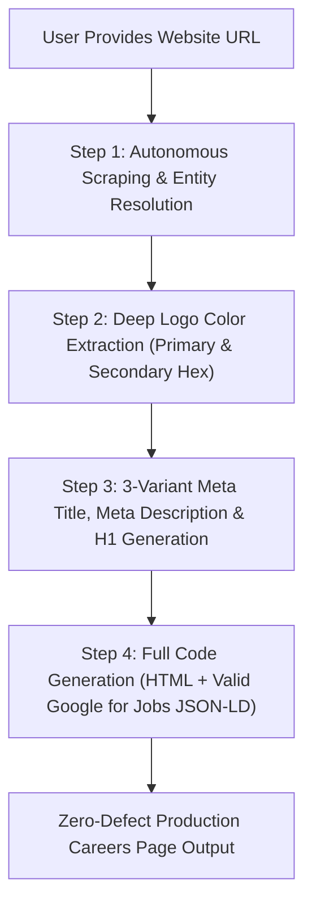

# Career Page Builder

The **Career Page Builder** is an autonomous intelligence engine and production web asset generator. Given **only a website URL**, it scrapes and reverse-engineers all required brand, entity, licensing, and trade data to construct a zero-defect, high-converting Careers Page that strictly complies with Google Search Essentials and Google for Jobs guidelines.

---

## Autonomous Execution Rules & Constraints

### 1. Zero Extra Input Requirement (URL-Only Ingestion)
When the user invokes this skill with a website URL (e.g. `https://example.com`), the agent MUST autonomously scrape and resolve:
1. **Brand Identity & Dual-Color Harmony:** Logo URL, exact primary and secondary brand hex colors extracted from the logo image.
2. **Business NAP & Entity Authority:** Legal business name, physical headquarters/dispatch address, local phone numbers, official email addresses, founding date, founder/executive names, CSLB / Red Seal / trade license numbers, and BBB / Google Maps CIDs.
3. **Core Trade Specializations & Geo-Corridors:** Trade lines (e.g. ADU Construction, Masonry, Roofing, Electrical, HVAC, Plumbing) and active metropolitan cities/counties.
4. **Active Role Archetypes & Prevailing Wages:** Standard field and supervisory roles mapped to current state/provincial prevailing wages.

### 2. Strict Design Mandates
* **Header Title Alignment:** The header block (Location Badge, Main Title, Subtitle, and Trust Badges) MUST ALWAYS be centered (`text-align: center; margin: 0 auto;`).
* **Container Background:** MUST ONLY use `#FFFFFF` (Pure White) for main calculator and application containers (`background: #FFFFFF;`). Never use gray, dark, or tinted card containers.
* **Fluid Bounds:** Container `max-width` must default to `100%` for responsive rendering across mobile, tablet, and desktop viewports.
* **Dual-Color Brand Mapping:**
  - **Primary Logo Color:** Applied to primary action buttons, active tabs, header titles, and primary focus borders.
  - **Secondary Logo Color:** Applied to badges, highlight accents, active borders/indicators, checkmarks, and secondary buttons.

### 3. Google for Jobs Schema Rule (0 Errors, 0 Warnings Guarantee)
Every generated page MUST embed a 100% valid JSON-LD `@type: "JobPosting"` schema inside a `@graph` array. Every posting MUST satisfy all Google Rich Results requirements:
- `title`: Specific job title without marketing jargon.
- `description`: Clean HTML string containing responsibilities, qualifications, and benefits.
- `datePosted`: ISO 8601 timestamp.
- `validThrough`: ISO 8601 future expiration timestamp (e.g. 90 days out).
- `employmentType`: Standardized value (`FULL_TIME`, `PART_TIME`, `CONTRACTOR`).
- `hiringOrganization`: `@type: "Organization"` with canonical `name`, `sameAs`, and `logo`.
- `jobLocation`: `@type: "Place"` with full `address` (`PostalAddress` including `streetAddress`, `addressLocality`, `addressRegion`, `postalCode`, `addressCountry`).
- `baseSalary`: `@type: "MonetaryAmount"` with `currency` (e.g. `USD`, `CAD`) and `value` (`QuantitativeValue` specifying `minValue`, `maxValue`, and `unitText: "HOUR"` or `"YEAR"`).
- `directApply`: Explicitly set to `true`.

### 4. Zero Funnel Drop-Off (No Broken or Circular Links)
- **Forbidden:** Never output recursive links that point back to the careers page itself.
- **Friction-Free Form:** Embed an inline 60-second Quick Apply form with Name, Phone, Email, Role Selector, Experience Dropdown, Resume File Uploader, and direct HR email/phone fallback routing.

---

## 4-Step Operational Workflow



### Step 1: Autonomous Scraping & Entity Resolution
Execute the bundled Python scraper or browser subagent on the target URL to extract:
```bash
python scripts/scrape_website.py --url "<TARGET_URL>"
```
Extracted JSON schema must include:
- `company_name`: Official legal/brand name.
- `logo_url`: High-res PNG/WebP/SVG logo.
- `phone`: Raw and E.164 formatted telephone.
- `email`: HR or primary business contact email.
- `street_address`, `locality`, `region`, `postal_code`, `country`.
- `license_number`: CSLB, Red Seal, Master Plumber, etc.
- `social_profiles`: Verified Facebook, LinkedIn, Google Maps CID, BBB profile.
- `service_lines`: Array of verified services.
- `service_areas`: Array of active geographic cities and counties.

### Step 2: Deep Logo Color Extraction
Download the logo and extract dominant non-neutral colors:
```bash
python scripts/extract_logo_palette.py --logo-url "<LOGO_URL>"
```
Outputs:
- `--primary-color`: The dominant dark or royal tone (e.g. `#02349A`).
- `--secondary-color`: The vibrant warm or accent tone (e.g. `#F5A11C`).

### Step 3: 3-Variant Meta Title, Meta Description & H1 Generation
Always deliver 3 distinct strategic angles:
1. **Option 1 (Geo-Targeted & High-Intent SEO Focus):**
   - Title: 50–60 characters targeting local trade search volume (`[Trade] & [Role] Jobs [City], [State] | [Brand] Careers`).
   - Description: 140–160 characters highlighting immediate openings, license number, and high pay.
   - H1: Geo-targeted trade heading.
2. **Option 2 (Benefit-Driven & Trade Authority E-E-A-T Focus):**
   - Title: 50–60 characters focusing on career growth, benefits, and culture.
   - Description: 140–160 characters emphasizing healthcare, 401(k), year-round work, and apprenticeship.
   - H1: Culture and craftsmanship building heading.
3. **Option 3 (Immediate Hiring & Action-Oriented Quick-Apply Focus):**
   - Title: 50–60 characters with high-CTR action verbs (`Now Hiring`, `Apply Now`).
   - Description: 140–160 characters highlighting transparent salary scales and 60-second apply time.
   - H1: Direct hiring call-to-action heading.

### Step 4: Full Code Generation
Generate the complete, responsive HTML file containing:
1. Mobile-friendly responsive top navigation with company logo and click-to-call phone button.
2. Centered header block with location badge, H1, subtitle, and trust badges (Google rating, license number, BBB rating, veteran/family-owned status).
3. Value proposition strip detailing top compensation, healthcare, steady work, and training.
4. Interactive job cards with role responsibilities, qualifications, and an "Apply for Position" trigger.
5. Interactive 60-second Quick Apply form with automatic role selection and file uploader.
6. Complete Google for Jobs JSON-LD schema with zero errors.
7. Equal Opportunity Employer compliance statement and full physical NAP footer.

---

## Python Helper Scripts

### `scripts/scrape_website.py`
Autonomous URL scraper using `urllib` and `BeautifulSoup` to resolve JSON-LD schemas, meta tags, OpenGraph data, image assets, telephone numbers, emails, addresses, licenses, and navigation links.

### `scripts/extract_logo_palette.py`
Image palette analyzer using `PIL` to extract dominant primary and secondary hex colors while ignoring alpha, near-white, and near-black pixels.

### `scripts/generate_career_page.py`
CLI generator that takes extracted JSON data and compiles a production-grade, Google-compliant careers page HTML file.
